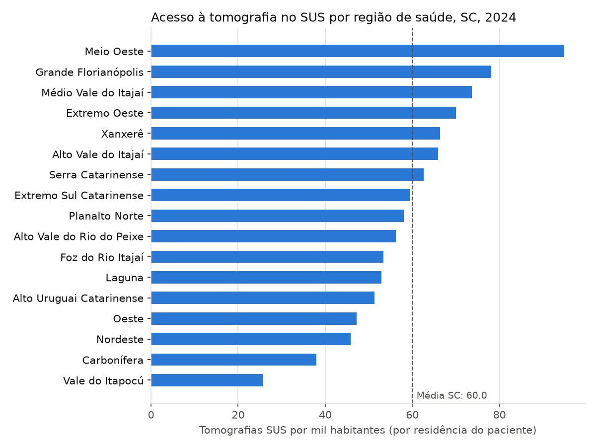
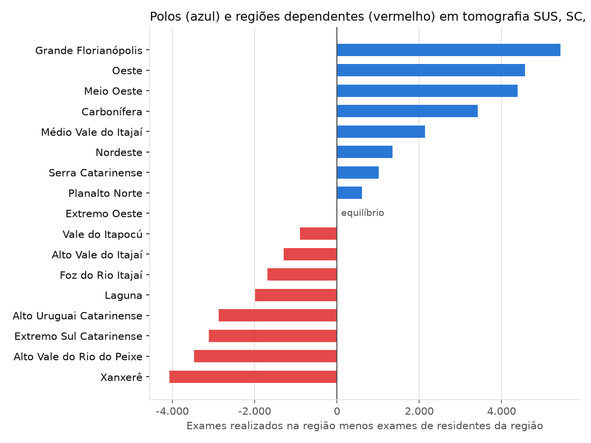
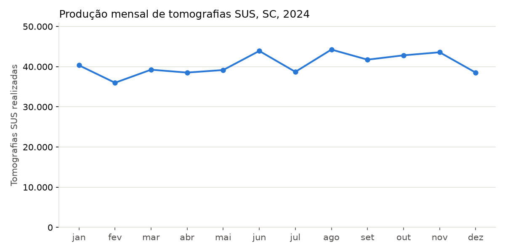

# Acesso à tomografia computadorizada no SUS em Santa Catarina (2024)

Análise da oferta de tomógrafos e da produção de tomografias pelo SUS nas 17 regiões de saúde de Santa Catarina, com dados públicos do DATASUS e do IBGE. O projeto cobre todo o fluxo de dados: extração automatizada, tratamento, auditoria de qualidade das bases, cálculo de indicadores e um dashboard interativo.

**[Acesse o dashboard interativo](https://tomografia-sus-sc.streamlit.app/)**, com mapa, filtros por região de saúde e por município, custo, tipos de exame e produtividade dos equipamentos.

## Pergunta

A oferta de tomógrafos e o acesso da população a tomografias pelo SUS são equivalentes entre as regiões de saúde de Santa Catarina?

## Principais achados

- Os moradores de Santa Catarina fizeram **482.321 tomografias computadorizadas** ambulatoriais pelo SUS em 2024, o equivalente a **59,9 exames por mil habitantes**.
- O acesso é desigual: a região de maior taxa, o **Meio Oeste**, tem **3,7 vezes** a taxa da região de menor acesso, o **Vale do Itapocú**. Entre as 17 regiões, a mediana é de 57,9 exames por mil habitantes, o desvio padrão é de 16,0 e o coeficiente de variação, de 27,3%.
- O estado terminou 2024 com **329 tomógrafos** cadastrados no CNES (eram 314 em janeiro), ou 4,08 por 100 mil habitantes. Apenas **203** estão disponíveis ao SUS pelo critério ajustado deste estudo, cerca de 2,5 por 100 mil habitantes.
- **Grande Florianópolis, Oeste e Meio Oeste** funcionam como polos: realizam milhares de exames a mais do que os demandados por seus moradores. **Xanxerê, Alto Vale do Rio do Peixe e Extremo Sul Catarinense** são as regiões cujos moradores mais dependem de outras regiões.
- O SUS aprovou **R$ 58,7 milhões** em tomografias ambulatoriais em 2024: **R$ 7,28 por habitante** e **R$ 121,63 por exame**, em média. O gasto por habitante acompanha o acesso, do Meio Oeste, o maior, ao Vale do Itapocú, o menor.
- **Abdômen e pelve** respondem por cerca de 44% dos exames, seguidos de **crânio** (cerca de 20%) e **tórax** (cerca de 18%).
- Cada tomógrafo com produção SUS fez, em média, cerca de **3,8 mil tomografias ambulatoriais** em 2024, com grande variação entre regiões. O Alto Uruguai Catarinense tem a menor produtividade, cerca de 1,1 mil exames por equipamento.
- A Carbonífera é um polo regional, mas seus moradores estão entre os que menos realizam tomografia pelo SUS. O dado merece investigação.







## Auditoria de qualidade dos dados

Antes de calcular os indicadores, as bases foram cruzadas entre si. As inconsistências encontradas e o tratamento dado a cada uma:

1. **Região de saúde no CNES não é confiável.** O campo `REGSAUDE` é preenchido manualmente pelos estabelecimentos e aparece em dezenas de formatos para a mesma região (`8`, `08`, `008`, `8ª`, entre outros). 263 dos 295 municípios aparecem associados a mais de uma região. **Tratamento:** a região de saúde foi obtida da base territorial oficial do DATASUS (`rl_municip_regsaud`).

2. **O indicador de disponibilidade ao SUS do CNES tem falhas.** 5 tomógrafos marcados como "não SUS" (`IND_SUS = 0`) registraram produção ambulatorial pelo SUS. O caso mais expressivo é um estabelecimento de Joinville com mais de 8 mil tomografias SUS em 2024. **Tratamento:** foi considerado disponível ao SUS o tomógrafo marcado como SUS no CNES **ou** com produção SUS registrada no SIA.

3. **Parte da produção vem de estabelecimentos sem tomógrafo cadastrado.** 9,8% das tomografias SUS de 2024 foram registradas por estabelecimentos sem tomógrafo no CNES, com destaque para Joinville. As hipóteses são serviços terceirizados, com o equipamento cadastrado em outro estabelecimento, ou falha de cadastro. Por isso, na região Nordeste o indicador de produção é mais representativo do que o de equipamentos, e esses exames ficam fora do cálculo de produtividade.

4. **PET-CT está no mesmo subgrupo da tomografia.** O procedimento 0206010095 (PET-CT) faz parte do subgrupo 0206 do SIGTAP, mas é realizado em outro equipamento, com código próprio no CNES, e tem custo muito maior. **Tratamento:** o PET-CT foi excluído de todas as análises, para que exames, custos e produtividade se refiram apenas à tomografia computadorizada.

## Fontes de dados

| Base | Conteúdo | Origem |
|---|---|---|
| SIA/SUS, arquivos PA | Produção ambulatorial, filtrada para o subgrupo 0206 (diagnóstico por tomografia) | FTP do DATASUS |
| CNES, arquivos EQ | Equipamentos por estabelecimento, filtrados para o código 11 (tomógrafo computadorizado) | FTP do DATASUS |
| SIGTAP | Nomes oficiais dos procedimentos (Tabela Unificada de dez/2024) | FTP do DATASUS |
| Base territorial | Relação oficial entre municípios e regiões de saúde (dez/2024) | FTP do DATASUS |
| Estimativas populacionais | População residente por município em 2024, tabela 6579 | API SIDRA do IBGE |
| Malha municipal | Contornos dos 295 municípios de SC, para o mapa | API de malhas do IBGE |

## Indicadores

| Indicador | Cálculo |
|---|---|
| Tomografias SUS por mil habitantes | Exames de residentes ÷ população × 1.000 |
| Saldo de exames | Exames realizados na região − exames de residentes da região |
| Exames feitos no próprio território | Exames de residentes feitos no próprio município ou região ÷ total de exames de residentes |
| Tomógrafos SUS por 100 mil habitantes | Tomógrafos disponíveis ao SUS (critério ajustado) ÷ população × 100.000 |
| Gasto SUS por habitante | Valor aprovado (`PA_VALAPR`) dos exames de residentes ÷ população |
| Valor médio por exame | Valor aprovado ÷ quantidade de exames |
| Produtividade | Exames realizados nos estabelecimentos com tomógrafo e produção SUS ÷ número de tomógrafos desses estabelecimentos |
| Desigualdade entre regiões | Mediana, desvio padrão, coeficiente de variação e razão entre a maior e a menor taxa por mil habitantes |

A quantidade de exames considera a soma de `PA_QTDAPR` (quantidade aprovada), e não o número de registros, porque um registro pode conter mais de um exame.

## Limitações

- O SIA registra apenas a produção **ambulatorial**. Tomografias de pacientes internados são faturadas pelo SIH e não estão incluídas. Por isso, a produtividade real dos tomógrafos é maior que a calculada.
- Foram considerados apenas os exames realizados em 2024 (`PA_CMP`). Exames de 2024 apresentados com atraso nos arquivos de 2025 não foram incluídos.
- O CNES é autodeclarado pelos estabelecimentos e pode conter desatualizações, como mostra a auditoria.
- A análise considera apenas a produção SUS. Exames pagos por planos de saúde ou particulares não estão nas bases.
- Em municípios pequenos, poucos exames mudam muito as taxas por habitante.

## Estrutura do projeto

```
tomografia-sus-sc/
├── app.py                       # dashboard em Streamlit
├── scripts/
│   ├── explorar_um_mes.py       # exploração inicial de um mês do SIA
│   ├── extrair_sia.py           # produção ambulatorial de tomografia, 12 meses
│   ├── extrair_cnes.py          # tomógrafos cadastrados no CNES, 12 meses
│   ├── extrair_populacao.py     # população por município (API do IBGE)
│   ├── baixar_sigtap.py         # nomes oficiais dos procedimentos (SIGTAP)
│   └── baixar_mapa.py           # malha dos municípios de SC (API do IBGE)
├── notebooks/
│   └── 02_analise.ipynb         # tratamento, auditoria, indicadores e gráficos
├── dados/
│   ├── brutos/                  # arquivos baixados (não versionados)
│   └── processados/             # bases tratadas e indicadores finais
├── figuras/                     # gráficos usados neste README
└── requirements.txt
```

## Como reproduzir

Requer Python 3.12.

```bash
python -m venv .venv
.venv\Scripts\activate          # Windows
pip install -r requirements.txt

python scripts/extrair_sia.py
python scripts/extrair_cnes.py
python scripts/extrair_populacao.py
python scripts/baixar_sigtap.py
python scripts/baixar_mapa.py
```

Depois, execute `notebooks/02_analise.ipynb`, que gera os indicadores por região, e rode o dashboard com:

```bash
streamlit run app.py
```

A extração do SIA leva de uma a duas horas, porque cada mês tem cerca de 3 milhões de registros.

## Tecnologias

Python, pandas, Streamlit, Plotly, matplotlib, dbfread, pyreaddbc, Parquet, GeoJSON, FTP do DATASUS e APIs do IBGE.

## Autora

**Rafaela Krann**, analista de dados com experiência em indicadores de saúde e gestão de serviços de diagnóstico por imagem.

[LinkedIn](https://www.linkedin.com/in/rafaela-krann) · [GitHub](https://github.com/Rafaelakrann)