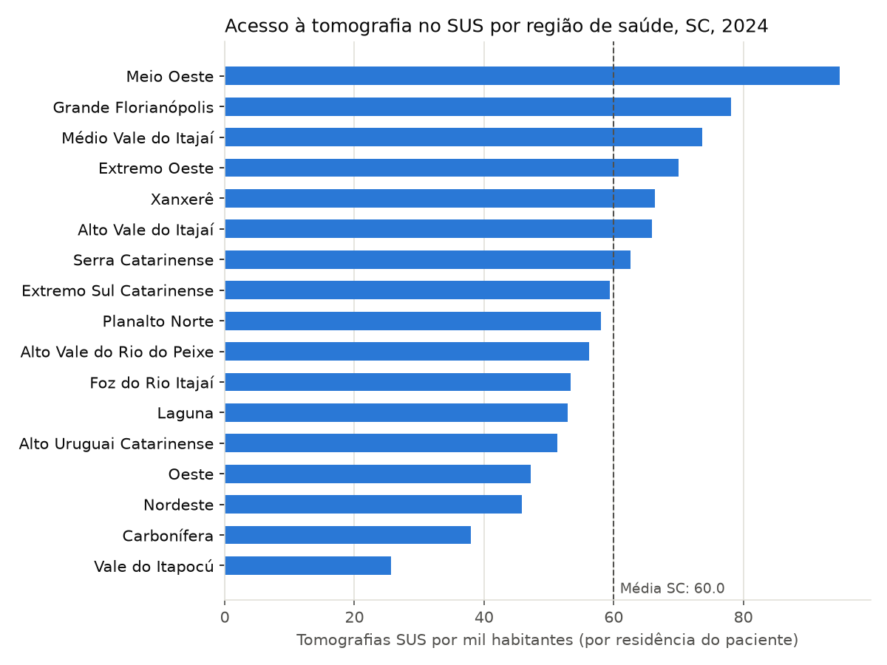
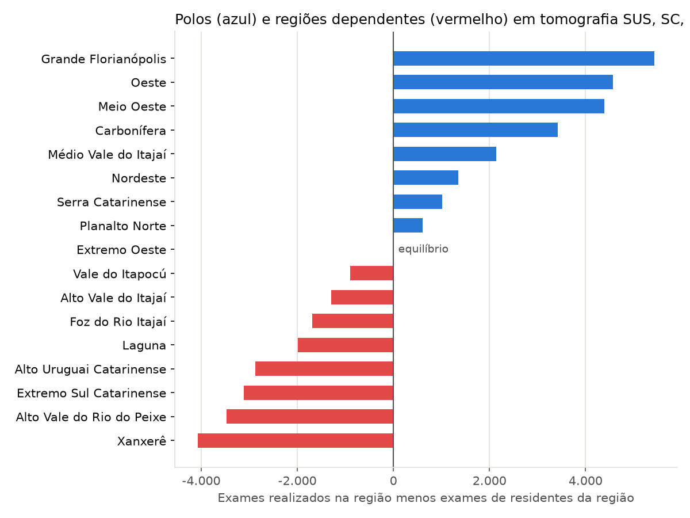
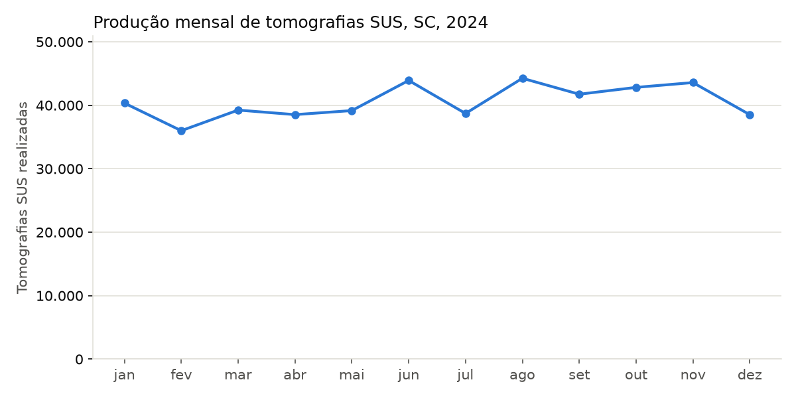

# Acesso à tomografia computadorizada no SUS em Santa Catarina (2024)

Análise da oferta de tomógrafos e da produção de tomografias pelo SUS nas 17 regiões de saúde de Santa Catarina, com dados públicos do DATASUS e do IBGE. O projeto cobre todo o fluxo de dados: extração automatizada, tratamento, auditoria de qualidade das bases, cálculo de indicadores e visualização.

## Pergunta

A oferta de tomógrafos e o acesso da população a tomografias pelo SUS são equivalentes entre as regiões de saúde de Santa Catarina?

## Principais achados

- **486.775 tomografias** ambulatoriais foram realizadas pelo SUS em Santa Catarina em 2024, o equivalente a **60 exames por mil habitantes**.
- O acesso varia quase **4 vezes** entre regiões: os moradores do Meio Oeste fizeram cerca de 95 tomografias SUS por mil habitantes, e os do Vale do Itapocú, cerca de 26.
- O estado terminou 2024 com **329 tomógrafos** cadastrados no CNES (eram 314 em janeiro), ou 4,08 por 100 mil habitantes. Apenas **203** estão disponíveis ao SUS pelo critério ajustado deste estudo, o que corresponde a cerca de 2,5 por 100 mil habitantes.
- **Grande Florianópolis, Oeste e Meio Oeste** funcionam como polos: realizam milhares de exames a mais do que os demandados por seus moradores. **Xanxerê, Alto Vale do Rio do Peixe e Extremo Sul Catarinense** são as regiões cujos moradores mais dependem de outras regiões.
- A Carbonífera é um polo regional, mas seus moradores estão entre os que menos realizam tomografia pelo SUS. O dado merece investigação.







## Auditoria de qualidade dos dados

Antes de calcular os indicadores, as bases foram cruzadas entre si. Três inconsistências relevantes foram encontradas e tratadas:

1. **Região de saúde no CNES não é confiável.** O campo `REGSAUDE` é preenchido manualmente pelos estabelecimentos e aparece em dezenas de formatos para a mesma região (`8`, `08`, `008`, `8ª`, entre outros). 263 dos 295 municípios aparecem associados a mais de uma região. **Tratamento:** a região de saúde foi obtida da base territorial oficial do DATASUS (`rl_municip_regsaud`).

2. **O indicador de disponibilidade ao SUS do CNES tem falhas.** 5 tomógrafos marcados como "não SUS" (`IND_SUS = 0`) registraram produção ambulatorial pelo SUS. O caso mais expressivo é um estabelecimento de Joinville com mais de 8 mil tomografias SUS em 2024. **Tratamento:** foi considerado disponível ao SUS o tomógrafo marcado como SUS no CNES **ou** com produção SUS registrada no SIA.

3. **Parte da produção vem de estabelecimentos sem tomógrafo cadastrado.** 9,8% das tomografias SUS de 2024 (47.725 exames) foram registradas por 56 estabelecimentos sem nenhum tomógrafo no CNES ao longo do ano, com destaque para Joinville. As hipóteses são serviços terceirizados, com o equipamento cadastrado em outro estabelecimento, ou falha de cadastro. Por isso, na região Nordeste o indicador de produção é mais representativo do que o de equipamentos.

## Fontes de dados

| Base | Conteúdo | Origem |
|---|---|---|
| SIA/SUS, arquivos PA | Produção ambulatorial, filtrada para o subgrupo 0206 (diagnóstico por tomografia) | FTP do DATASUS |
| CNES, arquivos EQ | Equipamentos por estabelecimento, filtrados para o código 11 (tomógrafo computadorizado) | FTP do DATASUS |
| Base territorial | Relação oficial entre municípios e regiões de saúde (dez/2024) | FTP do DATASUS |
| Estimativas populacionais | População residente por município em 2024, tabela 6579 | API SIDRA do IBGE |

## Indicadores

| Indicador | Cálculo |
|---|---|
| Tomografias SUS por mil habitantes | Exames de residentes da região ÷ população × 1.000 |
| Saldo de exames | Exames realizados na região − exames de residentes da região |
| Tomógrafos SUS por 100 mil habitantes | Tomógrafos disponíveis ao SUS (critério ajustado) ÷ população × 100.000 |

A quantidade de exames considera a soma de `PA_QTDAPR` (quantidade aprovada), e não o número de registros, porque um registro pode conter mais de um exame.

## Limitações

- O SIA registra apenas a produção **ambulatorial**. Tomografias de pacientes internados são faturadas pelo SIH e não estão incluídas. Por isso, tomógrafos hospitalares podem atender o SUS sem aparecer na produção analisada.
- Foram considerados apenas os exames realizados em 2024 (`PA_CMP`). Exames de 2024 apresentados com atraso nos arquivos de 2025 não foram incluídos.
- O CNES é autodeclarado pelos estabelecimentos e pode conter desatualizações, como mostra a auditoria.
- A análise considera apenas a produção SUS. Exames pagos por planos de saúde ou particulares não estão nas bases.

## Estrutura do projeto

```
tomografia-sus-sc/
├── scripts/
│   ├── explorar_um_mes.py       # exploração inicial de um mês do SIA
│   ├── extrair_sia.py           # produção ambulatorial de tomografia, 12 meses
│   ├── extrair_cnes.py          # tomógrafos cadastrados no CNES, 12 meses
│   └── extrair_populacao.py     # população por município (API do IBGE)
├── notebooks/
│   └── 02_analise.ipynb         # tratamento, auditoria, indicadores e gráficos
├── dados/
│   ├── brutos/                  # arquivos baixados (não versionados)
│   └── processados/             # bases tratadas e indicadores finais
├── figuras/                     # gráficos usados neste README
└── requirements.txt
```

## Como reproduzir

Requer Python 3.12.

```bash
python -m venv .venv
.venv\Scripts\activate          # Windows
pip install -r requirements.txt

python scripts/extrair_sia.py
python scripts/extrair_cnes.py
python scripts/extrair_populacao.py
```

Depois, abra e execute `notebooks/02_analise.ipynb`. A extração do SIA leva de uma a duas horas, porque cada mês tem cerca de 3 milhões de registros.

## Tecnologias

Python, pandas, matplotlib, dbfread, pyreaddbc, Parquet, FTP do DATASUS e API SIDRA do IBGE.

## Autora

**Rafaela Krann**, analista de dados com experiência em indicadores de saúde e gestão de serviços de diagnóstico por imagem.

[LinkedIn](https://www.linkedin.com/in/rafaela-krann) · [GitHub](https://github.com/Rafaelakrann)